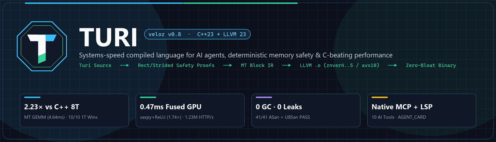
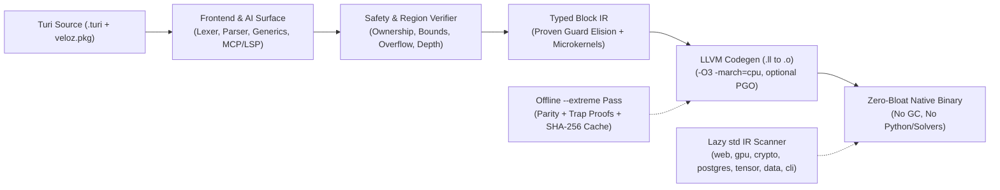
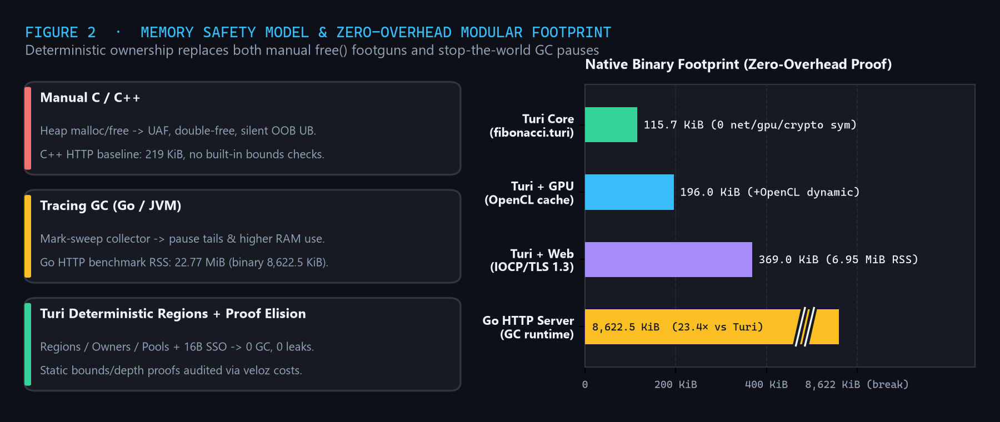

<div align="center">



<br><br>

[](LICENSE)
[](CMakeLists.txt)
[](CMakeLists.txt)
[](#quick-start)
[](#ai-native-toolchain-veloz-mcp--veloz-lsp)

<p>
  <a href="#for-ai-agents-instant-bootstrap">AI Bootstrap</a> •
  <a href="#why-turi">Why Turi</a> •
  <a href="#architecture--compilation-pipeline">Architecture</a> •
  <a href="#automatic-memory-safety--zero-overhead">Memory & Zero Bloat</a> •
  <a href="#verified-performance--honest-benchmarks">Benchmarks</a> •
  <a href="#code-showcase">Examples</a> •
  <a href="#modular-standard-library-std">Modular Stdlib</a> •
  <a href="#ai-native-toolchain-veloz-mcp--veloz-lsp">MCP & LSP</a> •
  <a href="#quick-start">Quick Start</a>
</p>

</div>

---

<div align="center">
  
</div>

---

## For AI Agents: Instant Bootstrap

> **Start here if you are an LLM or coding agent writing Turi:**
> 1. **Syntax & types in ~1.5k tokens:** Read [`AGENT_CARD.md`](AGENT_CARD.md) first (`5,638` chars; syntax-checked continuously by `tests/agent.py`).
> 2. **Connect live compiler feedback:** Run `veloz mcp` (stdio JSON-RPC 2.0, `10` tools) or `veloz lsp` before guessing fixes.
> 3. **Audit & edit surgically:** Inspect guards with `veloz costs <file> --explain-checks`, inspect symbols with `veloz sig` / `veloz slice`, and patch safely by content hash with `veloz patch` / `veloz patch-body`.
> 4. **Import only what you need:** Add `require <pkg> 0.1.0 "std"` in `veloz.pkg` (`web`, `gpu`, `tensor`, `crypto`, `data`, `cli`, `postgres`, `lienzo`). Unused packages emit **0 symbols and 0 bytes**.

---

## Why Turi?

Most languages force a tradeoff between **AI reliability**, **memory safety**, and **hand-tuned C/C++ speed**. Turi (`veloz`) is engineered to deliver all three simultaneously without garbage collection pauses, manual `malloc`/`free`, or unsafe `-ffast-math` numerical drift:

| Pillar | What Turi (`veloz`) Delivers | How It Stays Honest & Safe |
|---|---|---|
| **AI-Native by Design** | Single compact spec card ([`AGENT_CARD.md`](AGENT_CARD.md)), structured JSON diagnostics, automatic verified fixes (`veloz fix`), hash-verified symbol patching (`sig`/`patch`), and native **`veloz mcp` + `veloz lsp`**. | Canonical formatting (`veloz fmt`), predictable contracts, and deterministic compiler errors reduce repair loops and token waste. |
| **C/C++-Beating Native Speed** | Direct `.ll -> .o` LLVM lowering (`-O3 -march=znver4|znver5|sapphirerapids|graniterapids|avx10|native`), auto-parallelized non-FMA `f32` GEMM panels, Barrett `u16` modular reduction, vectorized `argmin.u16`, async IOCP/`epoll` HTTP + TLS 1.3, and fused OpenCL GPU kernels. | Beats hand-tuned AVX-512 C (`10/10` 1T kernels and `2.23×` over 8T OpenMP `matmul`) and matches/beats C/Rust/Go/Goose HTTP under strict IEEE-754. |
| **Deterministic Safety & Zero Bloat** | Automatic Region / Owner / Pool lifetime management, 16-byte SSO strings, rectangular `rows * cols` & strided `len / K` bounds proofs, and a modular `"std"` resolver. | Checks are elided **only** when statically proven redundant. Unused `"std"` modules emit **0 IR symbols and 0 bytes**. |

---

## Architecture & Compilation Pipeline

<div align="center">
  
</div>

Turi lowers source code cleanly through typed safety verification into target-specific machine code, keeping offline search and unused runtimes strictly out of production binaries:



---

## Automatic Memory Safety & Zero-Overhead

<div align="center">
  
</div>

Unlike tracing garbage collectors (which inflate binary sizes and heap RSS) or manual C/C++ pointers (which risk use-after-free and silent out-of-bounds UB), Turi tracks memory deterministically via regions, owners, pools, and 16-byte Small String Optimization (SSO). Every remaining runtime guard is transparent and auditable:

```json
$ veloz costs examples/fibonacci.turi --explain-checks
{"function":"fib","kind":"check","check":"overflow","status":"kept","file":"examples/fibonacci.turi","start":147,"end":152,"reason":"Posible desbordamiento en '+'; acota con 'requires' o usa wrappingAdd/Sub/Mul."}
{"function":"main","kind":"check","check":"depth","status":"eliminated","file":"examples/fibonacci.turi","start":228,"end":235,"reason":"Profundidad máxima de llamada acotada estáticamente (< 256 marcos)."}
```

And verifying zero bloat on [`examples/fibonacci.turi`](examples/fibonacci.turi):
- `veloz bench examples/fibonacci.turi --rounds 5` produces a **`115,712`-byte (`113.0 KiB`)** native executable (`17.944 ms` median run).
- `veloz emit-ir examples/fibonacci.turi` emits **0** `@tz_web_`, `@tz_gpu_`, `@tz_crypto_`, `@tz_pg_`, `@tz.gemm_f32_panel`, `@tz.matmul_mod`, or `@tz.argmin` symbols.

---

## Verified Performance & Honest Benchmarks

<div align="center">
  
</div>

All comparisons match functionality, checksums, and strict IEEE-754 arithmetic (`no -ffast-math`). Detailed raw benchmark harnesses and evaluation suites are excluded from the public git tree via `.gitignore`.

### 1. CPU Expert Ceiling (1T, Ryzen 7 7700X `znver4`)
**10 / 10 wins** vs expert hand-written `<immintrin.h>` AVX-512 C (+ PGO) with exact checksums and `n = 1..33` parity:

| Kernel | Turi v0.8 | Expert AVX-512 C | Speedup |
|---|---:|---:|---:|
| `dotProduct` | **887.9 ns** | 3,322.7 ns | **3.742×** |
| `integerVariance` | **651.2 ns** | 1,810.0 ns | **2.779×** |
| `maxPool` | **599.2 ns** | 1,410.5 ns | **2.354×** |
| `sparsePages` | **1,967.3 ns** | 3,899.8 ns | **1.982×** |
| `fivePoint` | **730.7 ns** | 1,341.0 ns | **1.835×** |
| `matrixMultiply` | **1,361.5 ns** | 2,151.7 ns | **1.580×** |
| `sobelHorizontal` | **1,110.1 ns** | 1,665.3 ns | **1.500×** |
| `roundRobin` | **8,211.4 ns** | 10,215.4 ns | **1.244×** |
| `floydDistances` | **790.5 ns** | 915.9 ns | **1.159×** |
| `selectionSort` | **1,945.2 ns** | 2,118.4 ns | **1.089×** |

### 2. Web HTTP/1.1 + TLS 1.3 (`64` connections, Windows IOCP, medians, `0` errors)

| Runtime | `ping` (`pipe=1 / 8`) | `estado` (`pipe=1 / 8`) | `item` (`pipe=1 / 8`) | `calcular` (`pipe=1 / 8`) | `valorar` (`pipe=1 / 8`) | Binary Size | Peak RSS |
|---|---:|---:|---:|---:|---:|---:|---:|
| **Turi** | 158k / 1,188k | 159k / 1,107k | 158k / **1,226k** | **160k / 1,227k** | **156k / 1,019k** | 369.0 KiB | 6.95 MiB |
| **C (`same_rt`)** | **163k / 1,236k** | **161k / 1,205k** | **160k** / 1,198k | 155k / 1,167k | 150k / 992k | 215.5 KiB | 6.39 MiB |
| **C (`fast`) / C++ (`same_rt`)** | — | — | — | — | 992k / 951k (`pipe=8`) | 165.0 / 219.0 KiB | — / 6.42 MiB |
| **Rust** | — | — | — | — | 329k (`pipe=8`) | 696.5 KiB | 8.60 MiB |
| **Goose** | — | — | — | — | 78k (`pipe=8`) | 164.0 KiB | 4.48 MiB |
| **Go** | — | — | — | — | 53k (`pipe=8`) | 8,622.5 KiB | 22.77 MiB |

### 3. Multi-Thread CPU `f32` + GPU OpenCL Fused Kernels (Ryzen 7 7700X + RX 9070 XT, `checksum_diff = 0.0`)

| Workload | Turi CPU (MT v0.8) | C++ AVX-512 1T | C++ AVX-512 8T | Turi GPU (Cold / Res) | C++ OpenCL (Cold / Res) |
|---|---:|---:|---:|---:|---:|
| `matmul` (`N=64 / 256 / 512 / 1024`) | **0.006 / 0.154 / 0.641 / 4.644 ms** | 0.014 / 0.972 / 6.067 / 54.226 ms | 0.361 / 0.505 / 1.650 / 10.375 ms | 0.263–3.454 / **0.119–0.987 ms** | 0.278–3.139 / 0.106–0.979 ms |
| `saxpy` (`16K / 262K / 4M / 16M`) | **0.002** / 0.039 / 1.914 / **7.695 ms** | 0.006 / **0.034** / 1.758 / 8.054 ms | 0.007 / 0.463 / **1.725** / 7.806 ms | 1.604–14.774 / **0.121–0.460 ms** | 1.680–15.351 / 0.115–0.464 ms |

- **Multi-thread CPU scaling:** Auto-parallelizing `@tz.gemm_f32_panel` across disjoint 4-row bands on `@tz_conc_parallel_for_coarse` cuts `matmul N=1024` from `29.400 ms` (`1T`) to **`4.644 ms`** (**`2.23×` faster than C++ AVX-512 8T OpenMP `10.375 ms`** and **`11.68×` faster than C++ 1T `54.226 ms`**), and wins at `N=512` (`0.641 ms` vs `1.650 ms`, `2.57×`) while honoring `TURI_THREADS`. `matmulAutoF32` dispatches at `~645³` ops (`268,435,456`, keeping `N=512` on fast CPU and `N >= 768` on GPU `1.201–3.454 ms`).
- **Fused GPU resident kernels (RX 9070 XT):** `saxpyReluResidentF32` (`16M`) runs in **`0.473 ms`** vs `0.822 ms` unfused (**`1.74×` faster**); `matmulReluResidentF32` (`N=1024`) runs in **`0.920 ms`** vs `1.144 ms` unfused (**`1.24×` faster**).
- **General bounds proofs & modern targets:** Static prover eliminates bounds checks across immutable rectangular `rows * cols` (both `repeat` and slice guards) and strided `len / K` loops (`--cpu znver5|sapphirerapids|graniterapids|avx10`).
- **Offline `--extreme` superoptimizer:** SHA-256 disk cache cuts recompile times from `10.69–13.23 s -> 1.46–1.85 s`, while workloads already lowered by base microkernels (`matmul_n38` `13.55 ms -> 13.31 ms`) fall within `0.984×–1.018×` process noise.

> [!NOTE]
> **Known Limits & Honest Caveats**
> - **PCIe Cold Copies & WDDM Staging:** Cold `saxpy <= 16M` over PCIe (`14.774 ms`) remains slower than CPU (`7.695 ms`), and on Windows WDDM RX 9070 XT the `uploadF32Pinned`/`downloadF32Pinned` staging API (`4.837 / 5.143 ms` for `64 MB`) incurs host-to-host staging `memcpy` overhead relative to direct WDDM `uploadF32`/`downloadF32` (`2.888 / 3.551 ms`). Resident fused kernels (`0.473 ms` / `0.920 ms`) are the intended high-throughput path.
> - **Untested Silicon & Backends:** CUDA Driver API + PTX 7.0 (`cuda`), Apple Metal (`metal`), and `--cpu avx10` are implemented and verified in build/codegen/probe tests (`backendName()`, `availableBackends()`, `TURI_GPU_BACKEND=metal` fallback, `--cpu avx10` object emission), but have **not yet been executed on physical NVIDIA, Apple Silicon, or Intel AVX10 hardware**.
> - **Unspecialized Scalar Loops:** Arbitrary non-pattern scalar loops continue to rely on safe standard LLVM vectorization alongside expanded static bounds elimination (`1D`, square, rectangular `rows * cols`, and strided `len / K`).
> - **Linux Verification Scope (`dev-adrian`):** Isolated Linux (`g++ 13.3.0`, QEMU 4 vCPU `SSE4.2`) compiled all `10` compiler C++ files cleanly, proved `kept_bounds=0` on rect/strided checks, verified `1T/4T` pthread `matmul` parity (`N=259` `1.609/1.965 ms`; `N=512` `11.113/7.730 ms`), headless `gpu.backendName() == "none"`, and passed a **gentle low-load** `epoll` (`500` reqs in `31.43 ms`, `p50=85.9 µs`) + `TLSv1.3` (`p50=41.4 µs`) check; full Linux HTTP saturation stress testing was intentionally avoided due to shared host load and a live production app (`inventario-app`).

---

## Code Showcase

### 1. Deterministically Checked Native Logic ([`examples/fibonacci.turi`](examples/fibonacci.turi))

```rust
fn fib(n: int) -> int {
    var a = 0
    var b = 1
    for i in 0..n {
        let next = a + b
        a = b
        b = next
    }
    return a
}

fn main() {
    print(fib(10))
}

test "décimo término" {
    assert fib(0) == 0
    assert fib(10) == 55
}
```

### 2. Modular Async Web Server (`veloz new api --template web`)

```rust
import servidor

extern "C" fn apiHello(ctx: MutPtr<void>) {
    servidor.jsonStart(ctx)
    servidor.jsonStr(ctx, "app", "api")
    servidor.jsonBool(ctx, "ok", true)
    servidor.jsonEnd(ctx, 200)
}

fn routeSetup(srv: servidor.Servidor) {
    servidor.staticRoute(srv, "/health", 200, "text/plain; charset=utf-8", "ok")
    servidor.getRoute(srv, "/", fnPtr(apiHello))
}

fn main() {
    let srv = servidor.newServer("127.0.0.1", 0, 2)
    routeSetup(srv)
    match servidor.startBg(srv) {
        Ok(p) => {
            print("Listening on port " + str(p))
            servidor.stop(srv)
        }
        Err(e) => eprint(e)
    }
    servidor.free(srv)
}
```

### 3. OpenCL GPU Auto-Dispatch (`veloz new compute --template gpu`)

```rust
import gpu

fn main() {
    let a = [f32(1.0), f32(2.0), f32(3.0), f32(4.0)]
    let b = [f32(2.0), f32(0.0), f32(1.0), f32(2.0)]
    var c = repeat(f32(0.0), 4)
    let _ = gpu.matmulAutoF32(a, b, mut c, 2, 2, 2)
    print(str(c.len()) + " GPU=" + str(gpu.isAvailable()))
}

test "small_matmul" {
    var out = [f32(0.0)]
    let r = gpu.matmulAutoF32([f32(1.0), f32(2.0)], [f32(3.0), f32(4.0)], mut out, 1, 2, 1)
    assert r.isOk() && out[0] == f32(11.0)
}
```

---

## Modular Standard Library (`"std"`)

Declare only what your project uses inside `veloz.pkg`:

```text
package myapp
version 0.1.0
require crypto 0.1.0 "std"
require data 0.1.0 "std"
```

| Package | Purpose | Key APIs / Modules | Runtime & Dependency Model |
|---|---|---|---|
| `web` | Async HTTP/1.1 (`IOCP` / `epoll`), WebSockets (RFC 6455), TLS 1.3, HTTPS client, SQLite WAL | `servidor`, `ws`, `cliente`, `tls`, `sqlite`, `http`, `json`, `router`, `mime` | Lazy IR injection (`--web` or call-site); dynamically loads OpenSSL 3 (`libssl-3-x64.dll` / `libssl.so.3`) & `sqlite3` |
| `gpu` | Fused OpenCL GPU compute + persistent binary disk cache + multi-backend probe + CPU/GPU auto-dispatch | `isAvailable`, `backendName`, `availableBackends`, `matmulF32`, `matmulAutoF32`, `matmulReluResidentF32`, `saxpyF32`, `saxpyAutoF32`, `saxpyReluResidentF32`, `uploadF32Pinned`, `downloadF32Pinned`, `reluF32`, `vecAddF32` | Lazy IR injection (`--gpu` or `import gpu`); dynamic `OpenCL.dll`/`libOpenCL.so` + CUDA Driver API / Metal probe — **0 symbols** if unused |
| `tensor` | Bounded `TensorF32` CPU arrays & neural/matrix primitives | `zeros`, `ones`, `fromArray`, `add`, `mul`, `relu`, `transpose`, `softmaxRows`, `matmul`, `dot` | Pure Turi; **0 OpenCL dependencies** |
| `crypto` | Native cryptography without OpenSSL compile dependency | `sha256Hex`, `hmacSha256Hex`, `constantTimeEq`, `randomBytes`, `aeadSeal`, `aeadOpen` (ChaCha20-Poly1305) | Pure C99 RFC implementations + OS CSPRNG (`BCryptGenRandom` / `getrandom`); **0 extra DLLs** |
| `data` | Structured parsing & serialization | RFC 4180 CSV (`parseCsv`, `parseCsvWithHeaders`, `toCsv`), RFC 8259 JSON (`parseJson`, `toJson`, `getStr`, `getInt`, `getBool`) | Pure Turi |
| `cli` | Declarative CLI option parser | `newSpec`, `addBool`, `addStr`, `addInt`, `parseArgs`, `formatHelp` | Pure Turi |
| `postgres` | Parameterized PostgreSQL client returning JSON rows | `available`/`disponible`, `connect`/`conectar`, `queryJson`/`consultarJson`, `exec`/`ejecutar`, `close` | Dynamic `libpq.dll` / `libpq.so.5`; clean `Err` if client library is absent |
| `lienzo` | Canvas / font-backed rendering helpers | 2D canvas & bundled font resources (`lib/lienzo/fuentes`) | Pure Turi module; only linked when imported |

---

## AI-Native Toolchain (`veloz mcp` & `veloz lsp`)

Drop `veloz` directly into any MCP-compatible AI coding environment (Claude Code, Cursor, Antigravity, etc.):

```json
{
  "mcpServers": {
    "turi": {
      "command": "veloz",
      "args": ["mcp"]
    }
  }
}
```

- **MCP Server (`veloz mcp`):** stdio JSON-RPC 2.0 (`2024-11-05`, supporting both line-delimited JSON and `Content-Length` headers) exposing 10 deterministic tools:
  - `turi_check` · `turi_sig` · `turi_slice` · `turi_types` · `turi_costs` · `turi_fmt` · `turi_fix` · `turi_patch` · `turi_explain` · `turi_run`
- **LSP Server (`veloz lsp`):** stdio JSON-RPC 2.0 with `didOpen`/`didChange`/`didSave`/`didClose`, live `publishDiagnostics`, type `hover`, and canonical document `formatting`.

---

## Quick Start

### Build `veloz` from Source

**Windows (LLVM 23.1.x + VS Build Tools + CMake + Ninja + Python 3.10+):**

```powershell
# Release build + full CTest suite
.\tools\build.ps1

# AddressSanitizer + UndefinedBehaviorSanitizer build & test
.\tools\build.ps1 -BuildDir build-san -Sanitize
```

**Linux / macOS (Clang + lld + CMake + Ninja + Python 3.10+):**

```sh
cmake -S . -B build -G Ninja -DCMAKE_BUILD_TYPE=Release
cmake --build build
ctest --test-dir build --output-on-failure
```

### Scaffold, Check, Run, Build & Benchmark

```sh
veloz new myapp --template cli     # templates: cli | web | gpu | lib
cd myapp
veloz check src/main.turi          # type, lifetime, effect & test check
veloz run src/main.turi            # reference checked interpreter
veloz build src/main.turi -o myapp --release --cpu native  # or znver4|znver5|sapphirerapids|graniterapids|avx10
veloz costs src/main.turi --explain-checks
veloz bench src/main.turi --rounds 5
```

---

## Documentation & License

| File | Purpose |
|---|---|
| [`AGENT_CARD.md`](AGENT_CARD.md) | Concise AI coding syntax & CLI reference (`~1.5k` tokens) |
| [`AGENTS.md`](AGENTS.md) | Repository architecture map for automated contributors |
| [`SPEC.md`](SPEC.md) | Formal language semantics, types, ownership, safety & IR specification |
| [`ESTADO.md`](ESTADO.md) | Implementation milestones and verification matrix |
| [`DECISIONES.md`](DECISIONES.md) | Architectural design decisions and explicit invariants |
| [`CONTRIBUTING.md`](CONTRIBUTING.md) | Safety invariants, zero-overhead rules & contributor checklist |
| [`CMakeLists.txt`](CMakeLists.txt) | Cross-platform C++23 build & CTest configuration |
| [`LICENSE`](LICENSE) | MIT License |
